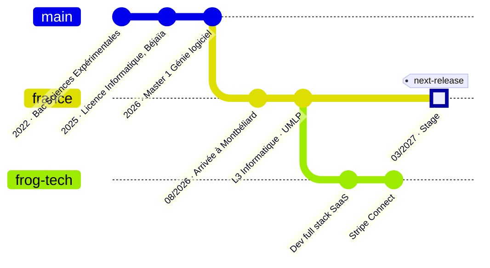

<div align="center">

# Ramy Benali · API Reference

**Full stack & SaaS developer — Laravel · TypeScript · paiement en ligne**


</div>

---

## Introduction

Cette API décrit un développeur. Elle est REST, renvoie du JSON, et elle répond vraiment :

```bash
curl https://ramy-benali.pages.dev/api/ramy
```

## The `developer` object

```json
{
  "id": "dev_RamyBenali",
  "object": "developer",
  "name": "Ramy Benali",
  "location": "Montbéliard, France",
  "role": "Full stack developer",
  "company": "Frog Tech",
  "education": {
    "current": "L3 Informatique — Université Marie et Louis Pasteur",
    "previous": "Master 1 Génie logiciel — Université de Béjaïa"
  },
  "languages": ["fr", "ar", "es", "de"],
  "currently_building": "Intégration Stripe Connect sur un SaaS en production",
  "available_for": {
    "type": "internship",
    "start": "2027-03-15",
    "duration_months": 3,
    "location": "Île-de-France"
  },
  "livemode": true
}
```

## Endpoints

| Méthode | Endpoint | Description |
| :-- | :-- | :-- |
| `GET` | [`/v1/stack`](#get-v1stack) | Technologies utilisées en production |
| `GET` | [`/v1/projects`](#get-v1projects) | Projets publics |
| `GET` | [`/v1/changelog`](#get-v1changelog) | Parcours, version par version |
| `POST` | [`/v1/hire`](#post-v1hire) | Proposer un stage |

---

### `GET /v1/stack`

| Scope | Valeurs |
| :-- | :-- |
| `backend` |    |
| `frontend` |   |
| `mobile` |  |
| `payments` |  |
| `infra` |   |
| `low_level` |   |

### `GET /v1/projects`

| `id` | `language` | `description` |
| :-- | :-- | :-- |
| [`HomeInspire`](https://github.com/RamyBenali/HomeInspire) | Java | Logiciel complet de gestion d'agence immobilière |
| [`SaldaeTrip`](https://github.com/RamyBenali/SaldaeTrip) | Dart | <!-- TODO : une phrase --> |
| [`GeoGuiz`](https://github.com/RamyBenali/GeoGuiz) | TypeScript | <!-- TODO : une phrase --> |
| [`SiteRP`](https://github.com/RamyBenali/SiteRP) | TypeScript | <!-- TODO : une phrase --> |
| [`Pong-Game`](https://github.com/RamyBenali/Pong-Game) | C | Pong en C |

### `GET /v1/changelog`



### `POST /v1/hire`

```bash
curl https://ramy-benali.pages.dev/api/hire \
  -d type="internship" \
  -d start="2027-03-15" \
  -d duration_months=3 \
  -d location="Île-de-France"
```

```json
{
  "status": 201,
  "message": "Created. Réponse sous 24 h.",
  "contact": {
    "portfolio": "https://ramy-benali.pages.dev/dev",
    "linkedin": "https://linkedin.com/in/ramy-benali-dev",
    "email": "benali.ramy.2@gmail.com"
  }
}
```

## Errors

| Code | Signification |
| :-- | :-- |
| `200` | Tout fonctionne |
| `402` | Café requis |
| `409` | Conflit de merge un vendredi à 18 h |
| `429` | Trop de réunions |

<div align="center">
<sub>Documentation générée à la main · dernière mise à jour : novembre 2026</sub>
</div>
