  

Développeur chez Frog Tech et étudiant en L3 Informatique à Montbéliard. Au travail, je fais du Laravel et du TypeScript sur un SaaS en production, surtout la partie paiement.

Ce code-là est privé. Ce qui est épinglé plus bas, ce sont mes projets perso et d'études : ils sont moins propres, mais ils sont à moi.

    

En ce moment

Une intégration Stripe Connect : onboarding des vendeurs, payouts, commissions.
En cours : théorie des langages, UML et C++.
Je cherche un stage de 3 mois à partir du 15 mars 2027, en Île-de-France.
  
 <a href="https://ramy-benali.pages.dev/dev">Portfolio</a> &nbsp;·&nbsp; <a href="https://linkedin.com/in/ramy-benali-dev">LinkedIn</a> &nbsp;·&nbsp; <code>curl ramy-benali.pages.dev/api/ramy</code> 

